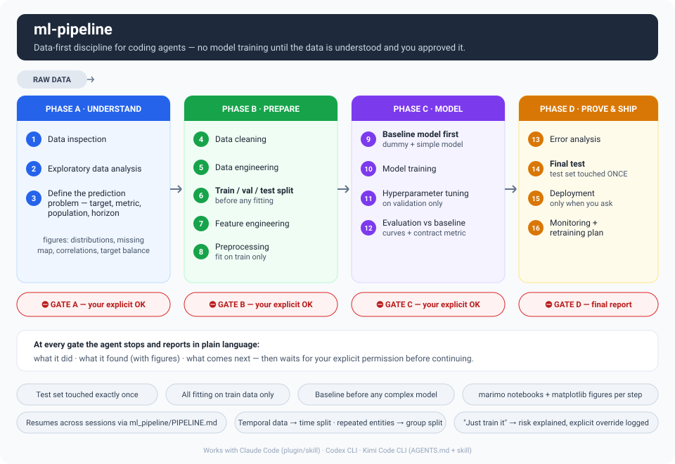

# ml-pipeline

**Stop your coding agent from jumping straight to model training.**

Coding agents love to call `.fit()` five minutes into an ML task — before looking at the
data, before there's a test set, before anyone agreed on what is being predicted. This
plugin forces a strict, data-first 16-step pipeline with explicit user-permission gates —
and, in Claude Code, a hook that makes skipping them impossible:



## Install

**Claude Code**

```
/plugin marketplace add jananthan30/ml-pipeline
/plugin install ml-pipeline@ml-pipeline
```

The skill activates automatically on any ML training/tuning/evaluation task, or invoke it
directly with `/ml-pipeline`.

**Codex CLI**

```
codex plugin marketplace add jananthan30/ml-pipeline
codex plugin add ml-pipeline@ml-pipeline
```

**Kimi Code CLI** (or Codex without plugins)

```bash
git clone https://github.com/jananthan30/ml-pipeline && cd ml-pipeline && ./install-other-tools.sh
```

Copies the skill into `~/.codex/skills/` and `~/.kimi-code/skills/` and appends an
enforcement section to each tool's global `AGENTS.md`.

## How it works

- **Strict order, no skipping** — the split happens *before* feature engineering and
  preprocessing; all fitting uses training data only; the test set is touched exactly once.
- **You stay in control** — at each gate the agent explains, in plain language, what it
  did, what it found (with figures), and what comes next, then waits for your explicit OK.
  Only *your* message approves a gate — the agent can't approve its own. "Just train it" gets
  the risk explained and needs you to say "override gate B".
- **One step at a time** — each finished step is recorded as `- Step N done: …`, and a step is
  accepted only after the steps before it and with its own evidence on disk (profile, figures,
  frozen split, logged baseline run, …).
- **Big and wide data** — the guard library reads Parquet/CSV/JSON-lines/Feather in batches, so
  profiling, EDA, splitting and the final test work on files larger than memory. EDA covers every
  column (ranked by target signal), and the agent reads a short summary instead of a huge JSON.
- **See everything** — [marimo](https://marimo.io) notebooks as the workbench, matplotlib
  figures saved to `ml_pipeline/figures/`, each explained in 1–2 plain sentences.
- **Resumable** — `ml_pipeline/PIPELINE.md` tracks every step and approval, so a new
  session continues where the last one stopped.

## Enforced, not just instructed

In Claude Code the plugin ships hooks. Before any command, file write, or notebook edit runs, a
`PreToolUse` hook scans the code — including the scripts, notebooks, and local modules a shell
command runs — and **denies**: any non-exploratory fitting before Gate A; model training before
Gate B; complex models before the baseline; tuning before the candidates; evaluating on the test
split before Gate C; fitting on the test split, ever. It also refuses edits to its own state files
and deletion of recorded ledger lines. A `UserPromptSubmit` hook records gate approvals from your
messages only, so a gate line the agent writes on its own doesn't count. A denied call tells the
agent exactly what is missing. A `PostToolUse` hook warns when a metric looks too good to be honest,
a split ignores class balance or time, or an output is so large it floods the agent's context.

At step 6 the agent switches to `guard.split()` / `guard.split_to_files()` / `guard.final_test()`, a
small runtime library that drops duplicates, refuses random splits when dates exist (even dates
stored as text), refuses row splits when an entity (patient, user, device) repeats, keeps a gap
between time periods, and lets the frozen test set be scored exactly once. `guard.cv_splits()` gives
leakage-safe folds, and `guard.log_run()` keeps a reproducible run log.

It also refuses to let understanding be skipped. `guard.profile()` writes a data profile — column
kinds, missingness, duplicates and label conflicts, class balance, dates (even when stored as text),
repeating entities, a ranked target signal per column, and **leakage suspects** (linear and
non-linear) — plus a one-page summary for the agent to read. `guard.eda_figures()` draws the figures
— every column, ranked by target signal — with explanations computed from the data. Gate A can't be
recorded without them and a written prediction contract; Gate B can't be recorded without a written
model rationale (traits → baseline → candidates → what was ruled out and why → metric). And seven
provably wrong applications are denied outright: a neural net on a small table, a random split on
temporal data, a non-group split on grouped data, accuracy as the selection metric on an imbalanced
target, resampling before the split, a complex model before the baseline, and tuning before the
candidates.

Prove it on the **canary**: `examples/canary/canary.csv` has a known honest ceiling of 0.80
accuracy. Beat it and you leaked. `ML_PIPELINE_ENFORCE=0` switches enforcement off for non-ML
projects; `ML_PIPELINE_TEST_NAMES=X_lockbox,y_lockbox` teaches the hook your own test-set names.
Codex and Kimi get the same rules as instructions (no hook support there).

The hooks stop an agent from skipping steps by accident or by habit, and from the common shortcuts
(running a hidden script, renaming the test set, editing its own approvals). They are pattern checks,
not a sandbox: code built specifically to evade them can still run. For a hard boundary, run the agent
without direct write access to `ml_pipeline/.approvals.json` and `.guard_state.json`.

## Development

```bash
pip install -r tests/requirements-dev.txt
python -m pytest tests
```

## License

Apache-2.0
